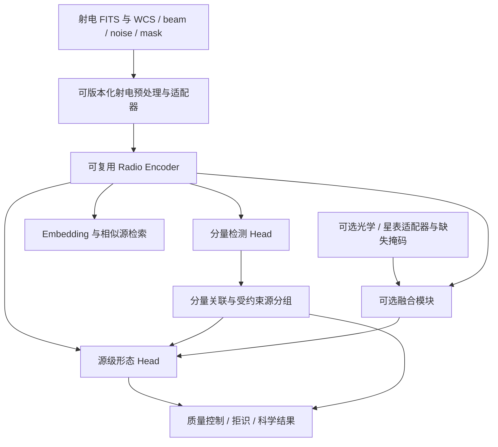

# TianGongKaiWu 射电源分类与识别专模：总体方案与20步实施计划

更新日期：2026-10-31。

**最终目标：构建借鉴 AION 表征学习与 DINO 检测思想的自主射电源分类、识别人工智能框架，训练可复用的射电领域专模，并发布其他天文学家能够安装、加载、推理和微调的权重与配套软件。**

本文件完整合并原 `PLAN.md` 与 `PLan_start.md`，是项目总体设计、实施步骤和验收标准的唯一维护正文。第1—10节定义目标、架构、数据与科学发布门槛；第11—14节给出执行约定、20步详细实施、下一轮编码顺序和交接模板。根目录两个旧文件仅保留导航入口。原来的分类与最小检测器保留为工程起点，最终交付扩展为经过真实数据验证的模型产品。

## 1. 最终交付与使用者

主要使用者是希望分析自己射电观测数据、构建源表、筛选特殊形态，或使用射电特征开展下游研究的天文学家。首发模型的适用巡天、频段、分辨率与输入视野必须明确，框架能力和某个权重的泛化范围分别说明。

最终需要同时交付三部分：

| 层次 | 必须交付的内容 | 完成判据 |
|---|---|---|
| 自主框架 | 数据契约、射电预处理、可复用编码器、检测/关联/分类任务头、训练与评价、Python SDK 和 CLI | 能训练、保存、恢复、替换任务头，并由自动测试维持接口兼容 |
| 科学专模 | 使用真实射电数据训练的编码器与任务权重、模型配置、类别定义、适用范围和科学验证报告 | 在锁定的真实留出集及外部测试上达到预先约定的科学门槛 |
| 用户发布包 | 安装包、完整模型包、校验和、文档、样例、许可与引用、model card | 非开发者在干净环境中按文档完成加载和推理，不依赖开发者目录、训练数据或隐式下载 |

“一个专模”体现为版本一致的编码器、任务头、预处理和标签体系；物理文件可以有一个或多个，统一由发布包解析。用户不需要自己拼装不匹配的 checkpoint。供研究使用的中间版本可以按任务发布，但必须声明只支持分类、检测或 embedding 中的哪些能力。

**项目完成的核心判据：至少两名未参与开发的天文学家，使用固定发布版本和公开样例，在自己的受支持环境中完成安装 → 获取模型 → 校验 → 加载 → 推理；其中至少一人完成自己的新数据推理，另有一次从发布权重开始的微调复现。** 该过程记录问题、环境和结果，不能由作者在原开发环境代替。

## 2. AION、DINO 与自主框架的关系

两份旧计划在“直接改造上游系统”和“自主实现框架”之间存在侧重点差异。更新后的主线是自主框架；上游模型用于架构参考、初始化候选和可复现实验对照，是否复用代码或权重由许可、收益及兼容性实验决定。

| 参考对象 | 吸收的思想 | 在本项目中的落实 |
|---|---|---|
| AION | 模态适配、可复用表征、编码器与任务分离、预训练模型加载 | 射电 encoder/embedding、自监督与多任务迁移、可选多波段适配器、完整权重发布 |
| IDEA-Research DINO | queries 集合预测、一对一匹配、定位与类别联合学习、多尺度与去噪改进 | 自主分量检测器，从当前单尺度最小实现逐步扩展，并与正式 DINO 对照 |
| 射电科学任务 | 分量不等于物理源，观测条件决定可识别性 | 独立关联模块、源级形态任务、beam/noise/WCS 约束、歧义与拒识 |

此处 DINO 指 *DETR with Improved DeNoising Anchor Boxes* 的目标检测实现。[官方仓库](https://github.com/IDEA-Research/DINO)；AION 官方架构包含模态 tokenizer 和统一 Transformer，公开模态列表未列出 RACS 射电图像。[官方仓库](https://github.com/PolymathicAI/AION) 因而本项目需要自己的射电输入适配与验证，不能仅替换模型名称或把射电图像标为光学 band。

采用以下开发选择：

1. 主线：自主射电编码器＋多任务头，射电单模态权重可以独立使用。
2. 对照：保留当前 CNN 与最小集合检测器，另评估正式 DINO 或其他既有方法的迁移收益。
3. 扩展：多波段融合、自监督和 AION 式统一模态建模按数据条件推进；先验证连续 embedding，再决定是否建设离散射电 tokenizer。

第一版公开科学权重不以“完整复现 AION 的规模与全部生成能力”为前提。多模态扩展不能使用户必须具备光学数据或安装整套上游研究仓库才能使用射电主模型。

## 3. 当前实现与证据边界

截至本次文档核对，仓库已有以下代码和留存证据：

| 能力 | 当前状态 | 距离最终目标的缺口 |
|---|---|---|
| 完整源切片分类 | `main.py`、`model.py`、`engine.py` 已有 CNN 训练/评估/预测 | 仍是独立脚本，尚无公开稳定 SDK、真实数据科学验收及统一发布契约 |
| 分量检测 | `detect.py` 与 `detection_*.py` 已有可变数量目标、背景空图、Hungarian 匹配、CE/L1/GIoU | 单尺度最小实现；未实现完整 DINO、多尺度、去噪或真实巡天检测验证 |
| 检测模型保存与评价 | 有 schema/预处理检查、原子保存、结果防覆盖、冻结清单验证 | 保护只覆盖检测入口；分类入口尚未获得同等契约；新外部清单评价尚未实现 |
| 训练与测试记录 | 留存 CPU 模拟 FITS 实验、123 passed/1 CUDA skipped 的测试输出 | 是已有工程验证记录，本次修改计划没有重跑训练或 pytest；不是 GPU/科学验收 |
| 公开模型与通用框架 | 尚未完成 | 没有发布安装包、稳定 embedding/fine-tune 入口、物理源关联或可公开科学使用的权重包 |

模拟检测证据：12 张 test 图、18 个真值分量，TP/FP/FN=6/30/12，固定阈值 F1=0.222222；误报仍多。[验证记录](detection-verification.md)、[指标原件](evidence/detection-2026-10-31/test_metrics.json)、[测试原件](evidence/detection-2026-10-31/pytest.txt)。这些权重应归为工程演示，不作为面向天文学家的科学模型发布。

## 4. 科学任务、输入与输出

首个候选数据域沿用原计划的 ASKAP RACS-mid，具体 release、分辨率产品、许可和样本规模尚待锁定。其 1367.5 MHz 发布及主/辅助目录可参考[原始发布论文](https://arxiv.org/abs/2311.12369)。首期优先选择河外源和质量可控区域；银道面、截断大源及其他巡天作为单独范围或挑战集，不据此预先承诺跨巡天泛化。

| 任务 | 输入 | 输出 | 科学边界 |
|---|---|---|---|
| 分量检测 | 射电视野、有效掩码及观测元数据 | 分量框/可选掩膜、类别、分数、定位质量 | 辐射分量不自动等于高斯拟合项或完整物理源 |
| 分量关联 | 分量视觉特征、相对天球几何、环境与可用宿主证据 | 关联概率、源分组、歧义与复核状态 | 防止距离连通造成链式误合并，保留无法确定的分组 |
| 源级分类 | 包含完整源的局部与上下文视野、关联结果 | 基础形态、结构属性、类别分数、拒识与质量标记 | 双叶不能自动判为 FR II；FR I/II 需分辨率与科学证据支持 |
| 表征提取 | 合规射电输入及条件元数据 | 有版本的 embedding、样本 ID 和有效性标记 | 特征可用于检索/迁移，未经验证不解释为某个物理量 |
| 可选多模态 | 射电＋可靠匹配的光学/星表等 | 融合表征与对应任务输出 | 缺失模态必须可用，错误配对和覆盖差异单独评估 |

基础形态先沿用紧致/未分辨、单体延展、多分量等可观察定义，再由试标确定互斥类别、属性和“无法判断”的关系。弯曲、弥散、单侧喷流、核—双叶等更适合属性标签；伪影、低 SNR、混叠、边缘截断与形态分开标注。

源级结果应保留 `source_id/component_ids/morphology_scores/association_score/quality_flags/review_status/model_version/data_release`。有可靠 WCS 时输出坐标及坐标系；缺失必要信息则标记不可计算，不伪造 RA/Dec、流量或角尺度。科学测量回到原始图像和测量方法，不能用检测框宽度或重建图像替代。

## 5. 数据、标签与科学防泄漏

1. **建立真实数据版本清单。** 包含 release、image/tile/source/component ID、原始 FITS SHA256、HDU/频率/偏振选面、单位、WCS、beam、pixel scale、local RMS、mask、标签版本、分区和数据使用条件。缺失项显式标记，并按任务决定拒绝或降级。
2. **先试标，再定标签与规模。** 先组织专家检查代表性样本和边界案例；原计划 500–1,000 例试标、5,000–10,000 例首轮监督、30,000–50,000 例主集仅作工作量估算。实际数量以复杂源覆盖、逐类有效标签和一致性为依据，不当作已取得数据。
3. **真实天空隔离先于切片。** 同一物理源、重复观测、重叠视野及不同分辨率版本同组；分区边缘设置与最大上下文视野匹配的隔离带。现有 group_id 字符串检查只能检查已提供的分组。
4. **锁定基准、保留外部评价。** 训练/验证/盲测清单与输入字节版本固定；阈值、校准和超参数只使用训练/验证数据。另建设 external evaluation 模式，记录新数据和模型版本、身份/内容/天空足迹的重叠审计；信息不足时不能标为独立盲测。
5. **保留观测意义。** 区分局部/上下文视野和像素/角尺度；预处理保留负值与 mask，记录缩放、裁剪、重采样、WCS 回投和 beam 变化。逐图 asinh/MAD 仍只是形态基线，不保留绝对流量。
6. **标注分歧可追踪。** 专家双标与裁决覆盖金标准子集；关联的不确定性、类别缺失和无可靠宿主作为合法状态。无标签预训练池不得静默混入锁定测试天空区域；传导式实验单独报告。

## 6. 目标架构与训练路线



这是目标结构，当前两个模型的独立 backbone 尚未合并为共享 encoder。分量检测特征和源级分类特征的尺度不同，先通过统一输入与特征接口支持独立模型，再比较共享骨干、局部/上下文编码与多任务训练，防止为“统一”而降低任务质量。

| 实验 | 内容 | 决策依据 |
|---|---|---|
| B0 | 星表/观测特征的简单统计或树模型 | 数据是否可学、复杂模型的增益基线 |
| B1 | 当前 CNN 的真实数据分类基线 | 完整源切片是否足够、错误来自何处 |
| B2 | 当前集合检测器升级，正式 DINO 作为独立对照 | 定位、困难负样本、多尺度和去噪各自的收益 |
| B3 | 分量关联＋源级分类闭环 | 减少误拆分/误合并，验证整体源识别能力 |
| B4 | 射电自监督/预训练编码器＋迁移任务 | 标签效率、跨区域泛化及 embedding 的独立价值 |
| B5 | B3/B4＋可选多波段连续表征融合 | 控制标签和覆盖后是否有独立增益 |
| B6 | 条件成熟时的射电 tokenizer 与统一模态训练 | 重建保真、真实任务收益与计算成本是否值得 |

对照固定数据版本、空间划分、预处理可比性和训练预算；报告多种随机种子及成本。多任务训练明确任务采样、损失权重、负迁移和独立任务回归。tokenizer 重建只作表示学习诊断，不作为新观测证据。

## 7. 面向天文学家的模型发布契约

以下目录为**拟定发布布局，尚未生成**；实际文件格式与导入名在接口任务中锁定。

```text
release/<model-id>/<release-version>/
  config.json                 # architecture、encoder/head 关系、输入/输出 schema
  weights/                    # 发布权重；格式在实现时选定并验证
  preprocessing.json          # 单位、尺寸、mask、变换与所需适配器版本
  labels.json                 # 稳定标签 ID、名称、层级及属性缺失语义
  calibration.json            # 已验证阈值/校准；未校准时明确记录
  provenance.json             # 代码 revision、训练配置/数据摘要、父权重、适用任务
  checksums.sha256            # 整个可分发模型包的文件摘要
  MODEL_CARD.md               # 适用域、指标、风险、失败案例、资源与引用
  LICENSES/                   # 代码、权重、数据/父权重所需声明
  examples/                   # 可分发的样例 FITS、期望结果和任务配置
```

权重包必须满足：

- **可重建模型。** architecture、任务、权重布局与兼容软件版本齐全；用户加载时不需要手写网络结构或另找训练脚本中的隐式参数。
- **可完整加载。** 如需 tokenizer、codec、backbone 或额外适配器，必须包含所需文件或明确列入下载清单；完整本地包断网可完成第一次预处理和推理。
- **可追溯与验证。** 明确模型 ID、发布版本、文件摘要、代码提交、数据/标签版本、父权重和训练/评价配置；加载损坏文件或不匹配的任务/类别/预处理时清晰拒绝，不静默部分加载。
- **可独立使用。** 推理不依赖训练 manifest；未知或缺失科学元数据按输入契约处理。单图、批量、embedding、源级结果和微调入口保持一致且有可执行示例。
- **可保留科学语义。** 标签分数与校准结果区分，检测与源级分类区分，坐标/单位/质量标记可审查；输出能追溯到输入文件和模型版本。
- **可维护升级。** 代码版本、模型架构版本、预处理/标签 schema、模型权重版本分别记录；有兼容矩阵和显式迁移策略，不能用同名文件静默替换模型行为。

提供 wheel/sdist 与声明支持的 Python/PyTorch 平台组合。CPU 基础推理为首发必须验证路径；发布 CUDA 支持时，单独给出实际验证的环境、显存和批量范围。下载地址、模型托管平台、包名、最终权重格式与许可证尚未锁定，不编造已经存在的包或公开模型地址。

## 8. 科学评价与发布门槛

科学阈值必须在真实数据试标后、最终盲测前由科学负责人锁定，写入版本化评价协议。旧计划的 Macro-F1≥0.90、关联 F1≥0.90、审查耗时减少≥50% 保留为待校准愿景，不能作为已经承诺或已经达到的数值。

| 验收维度 | 必须报告的证据 | 门槛/处理 |
|---|---|---|
| 分类 | Macro-F1、逐类 precision/recall/F1、support、混淆矩阵、区域 bootstrap 区间 | 与简单基线和专家一致性比较；数值目标在数据审计后冻结 |
| 检测 | 定义清楚的 AP/mAP、precision/recall、大小源及 beam 归一化定位误差 | 当前固定阈值统计不得更名为 mAP；新协议需独立验证 |
| 关联与源级输出 | Pairwise-F1、完整分组正确率、误拆分/误合并和源级识别表现 | 检测、关联、分类单项与完整链路分别验收 |
| Embedding | 冻结编码器的线性探针/少标签迁移、检索审查及跨区域表现 | 固定特征层、维数、池化和归一化协议，不以降维图美观代替评价 |
| 可靠度与稳健性 | 校准、拒识后的错误率/覆盖率，按 SNR/beam/角尺度/天空区/质量分层 | 必须公开失败范围；模型不适用时能拒绝或标记复核 |
| 外部泛化 | 未参与调参的真实区域/数据版本，内容与天空重叠审计 | 不能仅换文件名或 manifest 声称独立；域外结果单独列出 |
| 软件与权重 | 干净安装、摘要检查、真实样例加载/推理、断网重测、单/批一致性、微调 | 发布包逐项通过，文档示例在实际发布版本执行 |
| 第三方复用   | 至少两名外部使用者的环境、步骤与结果记录 | 不依赖作者目录/缓存/训练数据；发现问题后修复并复测相关路径 |

版本按证据划分，以下是计划里程碑名称，并不表示已发布：

- **工程预览包**：可安装、导出/加载、模拟样例可执行，明确标为 `engineering-demo`，不得命名为科学预训练权重。
- **任务级科学 beta**：真实数据与许可、固定输入/标签、锁定评价达到门槛，先发布明确任务的权重；未完成的关联或多模态能力不随包宣称。
- **射电专模 v1.0**：可复用 encoder/embedding、检测＋关联＋源级分类、真实与外部评价、模型卡、完整发布包及第三方复用验收齐备。多模态增强可独立发布，不阻塞已经合格的射电主模型。

## 9. 分阶段实施与资源

原“6个月原型、12个月科学发布”调整为条件式规划：以下月份从下一研发阶段启动起计，仅是预算草案；没有已确认人员、数据和算力时不视为交付日期。每阶段必须通过门槛，失败时先解决数据或错误模式再扩张模型。

| 阶段 | 参考窗口 | 工作与制品 | 退出条件 |
|---|---|---|---|
| S0 工程起点 | 已留存证据 | 当前分类/最小检测/模拟测试 | 只认可工程闭环，不标记科学完成 |
| S1 框架与模型契约 | M1–M2 | 安装包、统一加载/导出、公开接口、演示 bundle；并行真实数据试标 | 干净环境可用，数据与标签/评价协议锁定 |
| S2 真实数据基线 | M2–M3 | B0/B1/B2、错误可视化、分层报告、多尺度/负样本实验 | 在真实隔离数据上完成对照，必要时发布任务级 beta |
| S3 物理源闭环 | M3–M5 | 关联标注/模型、完整源分类、跨切片合并和回投 | 分量→物理源→形态链路独立验收 |
| S4 可复用射电表征 | M4–M6 | 可复用 encoder、自监督/迁移、embedding、微调与初步模型包；共享骨干仅在验证收益后采用 | 标签效率和复用价值有证据，形成射电研究原型 |
| S5 稳健性与可选融合 | M7–M9 | 校准/拒识、复杂/域外样本、B5；有条件才做 B6 | 真实外部评价与数据覆盖边界清楚，融合收益可解释 |
| S6 发布候选与验收 | M10–M12 | 最终权重、包/容器、model/data card、复现与引用、第三方试用 | 第8节全部相应发布门槛通过 |

数据审计/标注与模型包工程可并行。M6 根据主要错误来自标签、关联、表示或配对决定后续资源；AION 融合无独立收益时保留射电单模态主线。

角色至少覆盖科学定义与裁决、模型/训练、数据与评价、软件发布与用户支持。旧计划 4–5 FTE 仅为估算，实际投入待确认；发布工程与用户复现须列入工作量，不能只计算训练时间。

算力先 profile 再预算：分别记录 GPU 型号、数量、显存、峰值内存、样本吞吐、GPU-hour、存储与 I/O，按不同硬件单独核算。不预设需要复现 AION 的训练规模；无标签预训练和多模态训练仅在数据收益及资源可支撑时启动。模型卡同步给出普通用户推理和小规模微调的实际资源需求。

## 10. 当前待锁定项与下一步

| 待锁定项 | 影响 | 何时必须明确 |
|---|---|---|
| 首发真实数据 release、分辨率与使用/分发条件 | 数据输入、权重适用域、公开样例 | S1 数据冻结前 |
| 基础形态与关联标签、专家裁决规则 | head、标签映射、损失与验收 | S1 试标完成时 |
| 科学性能与可靠度门槛、外部测试定义 | 是否能发布科学权重 | 最终盲测前，结果出来后不能倒设 |
| 人员、可用 GPU/存储与预算 | 时间表、模型规模、预训练策略 | 各阶段启动前 |
| 软件包/模型 ID、托管方式、代码/权重许可证 | 外部用户安装、下载、再分发与引用 | 工程预览前确定临时规范，科学发布前正式锁定 |

**下一轮编码首先推进安装包与统一模型 bundle，再打通独立用户的加载/预测/embedding/微调路径；真实数据试标、科学输入契约和外部评价准备并行开展。** 任务、拟新增文件、TDD 和验收详见本文第11—14节。本轮为文档合并与系统分解，不把待开发接口、公开权重或科学验收写成已完成。

## 11. 执行约定与20步总览

**技术栈：** 沿用 Python、PyTorch、NumPy、Astropy、SciPy、pytest；新增依赖、权重格式与版本在实施时核对官方文档。

以下步骤说明“在做什么、当前完成了什么、完成后应得到什么”。所有拟新增文件路径均相对仓库根目录；所列未来接口不表示已经实现。

### 11.1 五个需要区分的对象

| 对象 | 在本项目中的含义 | 例子 |
|---|---|---|
| 模型架构 | 定义数据如何经过网络得到输出 | 当前的 `MorphologyCNN`、`TinySetDetector` |
| 权重 | 训练得到的参数，必须与架构及预处理匹配 | 现有任务各自的 checkpoint；有权重不等于已经科学验收 |
| 模型包（bundle） | 权重、配置、类别、预处理、版本与校验信息的整体 | 未来别人下载后可以完整加载的制品 |
| 框架 | 数据、模型、训练、评价和用户接口的可维护软件 | 未来可安装的 Python 包与 CLI |
| 科学专模 | 在真实数据上验证过、适用范围明确的模型及权重 | 面向已声明巡天/频段/分辨率的射电识别模型 |

每一步使用相同的说明：目的 → 依赖与输入 → 具体工作 → 当前已完成 → 制品 → 验收 → 完成后得到的能力。**“当前已完成”只写实际代码和留存证据；“完成后得到”描述目标，不代表现在已经具备。**

状态含义：**已有工程基线**＝受限范围内已有实现和工程证据；**部分完成**＝已有相应底层能力但未达到本步骤全部验收；**待开发**＝尚无对应可交付实现；**待科学确认**＝候选方向已提出，但真实数据或科学定义尚未锁定；**可选**＝不阻塞合格的射电主模型发布。

### 11.2 实施与验收规则（Global Constraints）

- 编码按 TDD：先写能抓住实际错误的测试并观察失败，再实现、运行相关测试与完整 suite。文档调整做一致性和链接检查，不伪造测试结果。
- 一次推进一个可验收的小步骤，完成后报告具体文件、验证结果和剩余问题。依赖未满足时先补依赖，不用空模块或固定返回值假装完成。
- 当前临时环境继承系统依赖，不能代替干净安装；只有实际验证的平台才能写入支持列表。
- 训练、验证、锁定测试和外部评价分别记录；科学数值门槛与评价协议必须在首次打开锁定 test 前冻结。
- 真实数据版本、许可、标签与专家门槛不足时明确记录；软件工程可以继续，科学验收不能提前勾选。
- 本文所有“拟新增”的文件、公共方法和包名均为设计目标；不生成尚不存在的安装命令或公开下载地址。
- 保留既有实验与用户改动；不自动提交。按仓库 `AGENTS.md` 在每轮完成后更新 `docs/handoff.md`，文档正文集中维护在 `docs/`；根目录保留导航入口。

### 11.3 重点审查的错误（Review Focus）

| 风险 | 必须验证的行为 | 对应步骤 |
|---|---|---|
| 权重可读但含义不匹配 | 错任务/架构/标签/预处理、损坏或缺文件时拒绝 | 03、20 |
| 仅作者环境可用 | 仓库外、干净环境、无缓存及完整本地包断网运行 | 02、04、20 |
| 射电数据语义丢失 | 选面、单位、WCS、beam、mask、裁剪与回投可追溯 | 07、09、10、15 |
| 数据泄漏或测试身份被改写 | 冻结基准与外部评价各自审计，不把训练数据报成独立测试 | 03、09、19 |
| 模型输出被过度解释 | 分量与物理源、分数与可靠度、工程与科学结果分别验收 | 12—20 |

### 11.4 20步总览与依赖

编号是讲解顺序，依赖决定执行顺序。软件主线从02开始；07—10的数据准备同时推进。无需等到全部软件封装结束才开始联系科学负责人和准备真实样本。

| 步骤 | 在做什么 | 完成后的主要结果 | 当前状态 |
|---|---|---|---|
| 01 | 盘点现有分类/检测链路与证据 | 知道能复用什么、哪里仍未验证 | 已有工程基线 |
| 02 | 建立可安装软件包和干净环境 | 其他机器能安装并调用现有模型 | 待开发 |
| 03 | 统一模型配置、权重导出与加载 | 分类/检测都能通过完整 bundle 恢复 | 部分完成 |
| 04 | 提供统一单图和批量推理 | 用户输入自己的合规 FITS 得到可追溯结果 | 部分完成 |
| 05 | 暴露稳定 embedding | 用户得到可复用、语义明确的特征向量 | 待开发 |
| 06 | 从父权重微调并保存新模型 | 用户适配自己的标签/数据且保留来源 | 待开发 |
| 07 | 锁定真实数据版本和使用范围 | 数据可追溯，知道哪些输入适用 | 待科学确认 |
| 08 | 定义标签并建立专家标注集 | 检测、关联、分类有一致的真实监督 | 部分完成 |
| 09 | 完成天空划分和实验冻结 | 可审计的训练/验证/盲测数据版本 | 部分完成 |
| 10 | 建立科学预处理和元数据契约 | 输入变换和坐标/单位关系明确 | 部分完成 |
| 11 | 训练真实数据分类基线 | 真实完整源切片的分类权重与错误报告 | 部分完成 |
| 12 | 训练并改善真实分量检测 | 有真实定位能力和规范检测指标 | 部分完成 |
| 13 | 学习分量之间的关联 | 多个辐射分量形成有证据的源分组 | 待开发 |
| 14 | 完成物理源级形态分类 | 检测、关联和完整源分类形成闭环 | 部分完成 |
| 15 | 支持大图切片、合并和坐标回投 | 从整幅图产生去重且可定位的源级结果 | 待开发 |
| 16 | 验证射电 encoder 的迁移价值 | 可复用编码器与经过评价的表征权重 | 待开发 |
| 17 | 增加可选多模态/统一模态能力 | 有证据的增强模型且射电单模态仍可用 | 可选，未开始 |
| 18 | 校准分数、拒识与质量控制 | 模型能表达不确定并给出复核线索 | 待开发 |
| 19 | 执行独立/外部科学评价 | 决定哪些任务和范围达到科学发布门槛 | 部分完成 |
| 20 | 构建发布包并由天文学家复用 | 可安装、可加载、可引用的科学专模 release | 待开发 |

与原6个任务的对应：任务1→02/03；任务2→04/05/06；任务3→07—12及19；任务4→13—15；任务5→16/17；任务6→18—20。01保留现有起点，18补足可靠度验收。

## 12. 20步详细实施与验收

### 步骤01：把现有成果和边界说明白

**在做什么：** 沿着数据流检查现有实现，建立后续改动的回归基线，避免重复开发或把待做功能当作已经完成。

**依赖与输入：** 当前源码、测试、历史分类记录与检测验证记录。

**具体工作与当前已完成：**

| 环节 | 实际在做什么 | 已完成的范围 |
|---|---|---|
| 模拟数据 | 生成高斯形态/分量，加噪声并写入 FITS 与标注 | `demo.py`、`demo_detection.py`；只是工程数据 |
| 图像读取 | 读主 HDU，检查二维和固定尺寸，构造信号/有效区域两通道 | `data.py`；尚无完整科学元数据契约 |
| 分类 | CNN 提取特征，输出整张完整源切片的类别分数 | `model.py`、`engine.py`、`main.py`；已有训练、选优、预测 |
| 检测 | 固定数量 queries 预测候选分量框和类别 | `detection_model.py`；单尺度最小集合检测器 |
| 匹配与学习 | 用 Hungarian 匹配预测框和真值，再计算类别及位置损失 | `detection_losses.py`；已有空图监督和框头梯度验证 |
| 保存与评价 | 保存最佳模型，恢复后评估/预测并写 JSON | 检测有版本校验、原子保存与冻结清单；分类保障尚未统一 |

**已有证据：** [检测验证记录](detection-verification.md)、[留存测试输出](evidence/detection-2026-10-31/pytest.txt)。其中记录123 passed、1 CUDA skipped；本轮仅核对文件，没有重新运行测试。模拟检测 F1=0.222222，不能视为真实 RACS 性能。

**完成后得到：** 可继续迭代的两条独立工程基线。尚无稳定安装包、统一模型包、公开 embedding、微调、物理源关联或科学权重发布。checkpoint 的“恢复”目前只用于评估/预测，不是断点续训。

**验收：** 实现文件与记录可定位，已有/缺失能力可区分；未来代码改动需通过相关回归测试。当前状态为“已有工程基线”，不代表整个系统完成。

### 步骤02：让框架能在别人机器上安装

**在做什么：** 将顶层脚本中的可复用逻辑整理成 Python 软件包，明确依赖、版本和入口。这是后续第三方调用的基础。

**依赖与输入：** 01；现有源码和已知可运行依赖组合。导入名暂拟 `tiangong`，实际发行名在实施时锁定。

**具体工作：**

1. 写安装失败测试：构建制品后，在仓库外、无 `system-site-packages` 的新环境导入并运行一个真实 FITS 样例。
2. 增加包元数据和包内模块，先迁移现有模型所需的最小代码，保留旧入口的行为回归。
3. 明确运行依赖、开发依赖、支持的 Python/平台；构建 wheel/sdist 后从产物安装，而不是依赖当前工作目录导入。
4. 执行依赖一致性检查、FITS→Tensor 转换和模型前向计算，记录环境与错误。

**当前已完成：** 有 `requirements.txt` 和 CPU 直接依赖约束；没有 `pyproject.toml`、可安装包或干净安装验收。

**制品与拟新增文件：** `pyproject.toml`、`src/tiangong/__init__.py`、包内基础模块、`tests/test_package_install.py`、安装说明。

**如何验收：** 新环境安装成功，仓库外调用成功，依赖和样例运行不借用作者目录/全局包；旧基线回归通过。单纯 `import` 成功不足以验收。

**完成后得到：** 其他开发者可以安装框架；此时尚不保证发布权重已经科学可用。

### 步骤03：让权重能够被完整、正确地恢复

**在做什么：** 将网络参数与其架构、标签和预处理绑定为统一模型包，避免“文件能打开，但解释方式不一致”。

**依赖与输入：** 02；现有分类/检测 checkpoint、对应结构和预处理。旧文件缺少的信息必须由已知来源确认，不能自动猜测。

**具体工作：**

1. 定义 bundle schema：任务、架构版本、类别顺序、输入规格、预处理版本、文件清单、checksum、训练来源与发布级别。
2. 先测两个模型导出/加载后 eval 输出一致；再测损坏权重、缺文件、错误任务/结构/类别/预处理均拒绝。
3. 实现受控模型工厂、导出、摘要校验、严格加载和原子写入；不通过配置导入任意模块，不回退到不安全 pickle 加载。
4. 将分类保存/加载和冻结 benchmark 身份纳入同等保障；保留检测已有保护。旧 checkpoint 走显式迁移并保留缺失信息说明。

**当前已完成：** 两个任务各自能加载 checkpoint；检测已有版本、架构检查与原子保存。统一 bundle、完整文件摘要、统一工厂未实现；分类 evaluate 尚不验证已保存的 manifest 摘要。

**制品与拟新增文件：** `src/tiangong/bundle.py`、`src/tiangong/registry.py`、`config/bundle-schema.json`、`tests/test_bundle.py`；两个标记为 `engineering-demo` 的演示包。

**如何验收：** 完整本地包可恢复原预测；坏包清晰拒绝；缺 tokenizer/codec 等必需资产时能在加载阶段发现；写入失败不破坏旧包，既有文件不被意外覆盖。

**完成后得到：** 用户加载一个模型包就能恢复正确模型，无须手动填写隐藏的网络参数。

### 步骤04：统一单图与批量推理

**在做什么：** 将“加载模型、读取图像、预处理、预测、输出”连成统一用户工作流。

**依赖与输入：** 03；合规 FITS 或文件清单。初期可以沿用固定尺寸契约，自动切片在15实现。

**具体工作：**

1. 固定输入和结果 schema；结果包含样本 ID、任务、模型版本、类别分数/框、坐标约定与质量状态。
2. 先写 SDK/CLI 行为测试：单图结果正确，单图与 batch 在声明容差内一致，顺序与样本 ID 不错配。
3. 实现单图/批量入口；批量中坏文件的失败方式必须明确，输出错误清单，不能静默漏样本。
4. 验证缺文件、坏 FITS、错误尺寸、全无效图、空输入和不可写输出；推理无须训练 manifest。

**当前已完成：** `main.py predict`、`detect.py predict` 各自支持单图；尚无统一 SDK 或面向用户的批量预测入口。训练 DataLoader 的批次处理不等于这个功能。

**制品与拟新增文件：** `src/tiangong/api.py`、`src/tiangong/cli.py`、`tests/test_public_api.py`、`examples/inference.py`。

**如何验收：** 从实际安装包运行示例；完整本地包在隔离、无缓存环境断网推理；结果与输入一一对应，坏输入有可理解诊断。使用隔离缓存测试，不删除用户已有缓存。

**完成后得到：** 天文学家能够把自己的合规 FITS 交给模型，拿到机器可读、可追溯的预测结果。

### 步骤05：提供稳定的特征向量 embedding

**在做什么：** 从射电图像提取可供检索、聚类或下游模型使用的特征，把 encoder 的复用能力开放给用户。

**依赖与输入：** 03、04；当前模型的 encoder/backbone 与需要提取特征的样本。

**具体工作：**

1. 明确特征来自哪一层、如何池化、向量维数、是否归一化以及不同模型是否可直接比较。
2. 先测固定维数、有限值、样本对齐、batch/single 一致、重复 eval 稳定及参数不变。
3. 实现公开提取入口与结果导出；无 embedding 能力的包明确拒绝，不能随便返回 logits 充当通用特征。
4. 给出小型检索/下游分析示例；实际迁移价值留到16验证。

**当前已完成：** 网络内部有 encoder/backbone；没有公开 embedding 接口、特征 schema 或迁移证据。

**制品与拟新增文件：** `src/tiangong/features.py`、`tests/test_embeddings.py`、`examples/embeddings.py`，以及 bundle 中的特征语义定义。

**如何验收：** 用户从发布格式的包提取到正确维度的向量，结果绑定样本和模型版本；所有工程测试通过，不把向量输出本身写成科学有效性证明。

**完成后得到：** 框架可以提供可复用特征；其任务收益由后续真实实验说明。

### 步骤06：支持从已有权重微调

**在做什么：** 允许用户在专模基础上适配新标注和任务，并明确哪些参数继承、冻结和更新。

**依赖与输入：** 03、04、工程样例及训练配置；真实数据微调还须通过08/09的标签和划分要求。

**具体工作：**

1. 定义父模型、标签映射、任务头替换、冻结/解冻策略、学习率和输出新版本。
2. 先测初始化来自父权重、冻结参数不变、训练参数确实更新、类别变化显式适配、父包字节不被覆盖。
3. 实现微调入口，记录父模型摘要、训练数据和新配置；模型选优只用 val。
4. 保存新 bundle，重新加载后评价/预测。若另外实现断点续训，须保存优化器、调度器、随机状态与训练步数并单独验收。

**当前已完成：** 两个现有 train 入口都从新模型开始；evaluate/predict 能恢复权重，但不构成微调或续训。

**制品与拟新增文件：** `src/tiangong/training/finetune.py`、`tests/test_finetune.py`、`config/finetune-example.json`、`examples/finetune.py`。

**如何验收：** 从实际父包完成小规模微调、保存、重载和预测，参数变化符合配置，test 不参与选优，来源可追踪。仅观察 loss 下降不足以证明加载了父权重。

**完成后得到：** 其他天文学家能够基于发布专模继续训练自己的任务。

### 步骤07：锁定真实数据及适用范围

**在做什么：** 明确模型实际学习哪一批观测数据，哪些观测条件属于支持范围。

**依赖与输入：** 科学负责人、候选 RACS-mid 数据及使用条件；此步可与02—06并行。

**具体工作：**

1. 锁定 release、图像产品、频率/偏振/HDU、单位、分辨率、覆盖区域及使用/分发条件。
2. 为原始文件记录内容 SHA256、观测/图像身份、来源和必要元数据，区分原图与派生切片。
3. 统计 beam、pixel scale、RMS、无效像素和质量差异，给出纳入、排除与待确认项。
4. 制作可重复读取的试验子集和数据卡；不把星表记录自动当成物理源形态真值。

**当前已完成：** 原计划选 RACS-mid 为候选；有模拟 manifest，但尚无已冻结、已验收的真实 release 和训练集。

**制品与拟新增文件：** `docs/data_protocol.md`、`docs/data_card.md`、`config/data-schema.json`、`src/tiangong/data/manifest.py`、`tests/test_data_manifest.py`。

**如何验收：** 任意样本可追溯到原始字节和产品；缺失元数据明确标记；不支持的输入不能被默认为合格。数据使用与样例分发条件已记录。

**完成后得到：** 一份可以指导标注、训练和发布声明的真实数据基础。

### 步骤08：建立标签体系和专家标注

**在做什么：** 把科学判断转成一致、可学习的监督信号，分别回答“哪里有分量”“哪些分量属于同一源”“源是什么形态”。

**依赖与输入：** 07的样本、领域专家、当前分类 CSV 和检测 JSON 约定。

**具体工作：**

1. 定义分量框/可选掩膜、component→source 关联、基础形态、结构属性和质量标签，明确坐标和缺失值语义。
2. 给出紧致/未分辨、延展、多分量以及弯曲/弥散等正反例；不将双分量自动标为 FR II。
3. 小批量试标并开展双标/裁决，保留分歧、关联不确定、截断源与无法判断状态。
4. 先测标签 ID、类别范围、框边界、重复身份和跨文件关系，再实现标注验证与统计；之后扩大标注。

**当前已完成：** 有分类标签与检测框的工程 schema；没有专家确认的完整标签体系或真实关联真值。

**制品与拟新增文件：** `docs/annotation_guide.md`、`config/label-schema.json`、`src/tiangong/data/annotations.py`、`tests/test_annotations.py`、版本化标注与一致性报告。

**如何验收：** 训练样本、分量、物理源和标签可以互相追踪；专家分歧可见；错误标注被拦截；逐类/复杂源覆盖有数量记录。

**完成后得到：** 可用于检测、关联和分类的真实监督数据，而不仅是类别名称列表。

### 步骤09：划分天空区域并冻结实验

**在做什么：** 让训练、验证和测试的独立性可审计，防止同一源以不同切片、文件名或分辨率出现在多个分区。

**依赖与输入：** 07、08；原图足迹、物理源身份、重复观测关系和最大上下文视野。

**具体工作：**

1. 先做天空/源分组，再切片；处理重叠图像、重复观测和分区边缘隔离带。
2. 同时保留身份、内容摘要和天空足迹审计，不能只比较路径或字符串 group_id。
3. 在首次打开锁定 test 前，冻结科学数值门槛、指标计算约定和评价协议；模型阈值、校准和超参数仅在 train/val 确定。
4. 先测跨分区同源/同内容/重叠区域、清单改写、空分区和预训练池污染，再实现冻结 manifest 及审计工具。

**当前已完成：** 两类清单已有部分 group/path 检查；检测 evaluate 比对冻结 manifest 字节；尚无真实天空审计、图像内容版本或完整数据冻结。分类保护仍待03统一。

**制品与拟新增文件：** `src/tiangong/data/spatial_audit.py`、`config/evaluation-protocol.json`、`tests/test_split_audit.py`、冻结清单及审计报告。

**如何验收：** 已知重复与重叠样例被识别，无法确认独立性的样本明确隔离或标记；测试身份不能靠改 split 绕过；阈值和协议的冻结时间早于盲测。

**完成后得到：** 可复现实验划分和独立测试的依据。外部新数据仍走19的独立协议。

### 步骤10：完善科学预处理与观测条件输入

**在做什么：** 把不同观测条件的 FITS 变成模型输入，同时保存变换关系与原始科学意义。

**依赖与输入：** 07的输入规格、09的冻结原则；原始图像、mask、WCS、beam、单位和噪声信息。

**具体工作：**

1. 明确 HDU/频率/偏振选面，检查单位与必要元数据；缺失时按任务拒绝或降级，不伪造物理量。
2. 定义局部与上下文视野、信号/mask/可选噪声通道及观测元数据编码，记录归一化参数。
3. 为裁剪、旋转、缩放建立图像/框/mask/WCS 一致变换；涉及重采样时声明 beam 和单位处理。
4. 先用手算几何、负值/极值/全无效图及边界样例测试，再实现；原图保持可追溯，测量与形态归一化分开。

**当前已完成：** 有二维主 HDU、固定尺寸、asinh/MAD、mask 和极值统计保护；没有完整科学预处理或观测元数据条件化。

**制品与拟新增文件：** `src/tiangong/data/fits.py`、`src/tiangong/data/transforms.py`、`tests/test_science_inputs.py`、`tests/test_geometry.py`、预处理 schema。

**如何验收：** 已知坐标回投正确、mask 与标签同步、错误元数据有诊断；同一版本的训练和推理使用同一预处理。

**完成后得到：** 可在声明观测条件内使用的输入适配器，并为检测、分类与大图处理共享。

### 步骤11：建立真实数据分类训练基线

**在做什么：** 用真实完整源切片确认形态任务可学，并找到标签、视野和模型的主要错误。

**依赖与输入：** 02—04、08—10；从零训练或06的明确初始化策略。

**具体工作：**

1. 固定训练配置、数据/代码版本与随机种子，先验证小样本过拟合和验证阶段不更新参数。
2. 建立 B0 简单特征基线与 B1 CNN 对照，固定相同划分和标签，记录资源开销。
3. 保存 loss、逐类指标、混淆矩阵和错误样例；模型选优只使用 val。
4. 在 val 中分析标签分歧、源截断、低 SNR、观测条件差异或模型不足。任务级候选冻结后才按09/19执行锁定测试；若据其结果再开发，后续版本另设未见验收数据。

**当前已完成：** 已有分类训练/选优/预测代码和模拟记录；尚未在锁定真实数据上完成上述验收。

**制品与拟新增文件：** `src/tiangong/training/classification.py`、`config/train-classification.json`、`tests/test_classification_training.py`、真实基线权重和错误分析报告。

**如何验收：** B0/B1 数据与预算可比、训练可恢复用于推理、逐类 support 完整；按已冻结门槛决定任务是否合格，不以总 accuracy 替代复杂源表现。

**完成后得到：** 一个适用范围明确、质量有真实证据的完整源切片分类模型。

### 步骤12：建立并提升真实分量检测

**在做什么：** 在包含多个目标及空背景的视野中定位辐射分量，并控制误检和漏检。

**依赖与输入：** 08—10、现有最小检测器与公开模型包约定。

**具体工作：**

1. 将真实分量框、负样本和质量标签接入 B2；保留 Hungarian 匹配、背景监督和框梯度回归测试。
2. 检查单图目标数与查询数、弱/小源、大源、旁瓣和混叠场景，避免静默截掉目标。
3. 实现并验证 AP/mAP 的明确约定，保留固定阈值 TP/FP/FN；增加 beam 归一化位置误差和分层结果。
4. 根据 train/val 错误逐项比较采样、增强、多尺度、去噪与正式 DINO 对照；每项记录代价和收益。任务级候选冻结后按09/19执行测试，不在迭代中反复查看盲测结果。

**当前已完成：** 单尺度检测、匹配、损失和模拟 CPU 闭环已存在；固定阈值统计不能称 mAP，当前模拟质量也未达到科学验收。

**制品与拟新增文件：** `src/tiangong/models/heads/detection.py`、`src/tiangong/evaluation/detection.py`、`tests/test_detection_metrics.py`、真实检测权重、对照与误检/漏检报告。

**如何验收：** 指标用手算/受控样例验证，重复框计误报，空图仍参与统计；真实定位与逐条件表现达到预先冻结的门槛。

**完成后得到：** 能定位分量的射电检测模型；分量的物理归属在13处理。

### 步骤13：判断哪些分量属于同一个物理源

**在做什么：** 把分量之间的关系作为独立学习任务，识别双叶、核—叶等可能属于同源的结构。

**依赖与输入：** 08的关联真值、09/10的科学几何、12的分量特征和预测。

**具体工作：**

1. 建候选分量对，记录角距离、方向、形态特征、可用流量/尺寸、局部环境和可选宿主证据；缺失量显式标记。
2. 训练成对关联分类器，再设计有约束的分组及歧义输出，不直接把高分边的连通分量当作确定物理源。
3. 先测邻近不同源、A–B/B–C 高分但 A–C 不支持、漏检分量、截断源和多候选宿主，再实现分组。
4. 同时在真值分量和实际检测分量上评价，区分关联错误与上游检测误差。

**当前已完成：** 尚无关联模型、候选对数据集或源分组实现。

**制品与拟新增文件：** `src/tiangong/association/pairs.py`、`model.py`、`grouping.py`（均在同一 association 目录）、`tests/test_association.py`、关联权重和分组报告。

**如何验收：** Pairwise-F1、完整分组正确率、误拆分和误合并都报告；歧义可保留且可复核；成对准确率不能替代整组验收。

**完成后得到：** 带置信/歧义状态的 component→source 映射，供源级分类使用。

### 步骤14：完成物理源级形态分类闭环

**在做什么：** 根据完整物理源的局部/上下文视野及关联结果判断形态，连接检测和分类。

**依赖与输入：** 11、13以及08的源级标签；大图跨边界部分与15联合验证。

**具体工作：**

1. 从源分组构建完整源输入，保留未关联、缺失或截断分量的质量状态。
2. 定义基础类别与多标签属性输出；不把可观察形态直接等同于 AGN/SF 等物理类型。
3. 先测输入分量顺序、关联不确定、缺失属性标签和视野截断，再接入分类 head。
4. 比较直接分类与检测→关联→分类；分别报告真值分组和预测分组下的性能，检查错误传播。

**当前已完成：** 有预裁剪完整源的独立 CNN 分类；没有使用检测/关联结果的源级闭环。

**制品与拟新增文件：** `src/tiangong/models/heads/morphology.py`、`src/tiangong/inference/source_pipeline.py`、`tests/test_source_pipeline.py`、源级结果 schema 和联合评测报告。

**如何验收：** 同一物理源有稳定身份、分量列表、形态输出和质量标记；分类与关联指标分开，并通过端到端真实测试。

**完成后得到：** 输入视野中的辐射结构能够形成物理源候选及源级形态判断。

### 步骤15：处理整幅 FITS 与跨切片源

**在做什么：** 将只接受固定尺寸切片的模型用于大图，并正确合并重叠区域及回投坐标。

**依赖与输入：** 10、12—14；原始大图、WCS、上下文视野和边界处理规范。

**具体工作：**

1. 设计按角尺度/输入规格切片的策略，记录 tile 足迹、重叠区、padding 和有效区域；给大尺度源保留上下文。
2. 将每个预测回投到原图/天球坐标，按明确定义去重；处理跨 tile 的关联与源 ID。
3. 先测边缘截断、大源跨界、相邻独立源、重叠重复框、坐标绕回和无效边界，再实现合并。
4. 增加可恢复的批处理进度和失败记录；重跑不重复计数，不静默遗漏失败切片。

**当前已完成：** 当前入口只接受指定固定尺寸图像；没有大图切片、跨片合并或 WCS 回投。

**制品与拟新增文件：** `src/tiangong/inference/tiling.py`、`merge.py`、`batch_jobs.py`（均在 inference 目录）、`tests/test_tiling.py`、`tests/test_catalog_merge.py`、整图运行记录。

**如何验收：** 手算几何测试与真实大图抽查都通过，源不因切片而重复/遗漏，失败与恢复有可见记录；测量方法和不确定性独立记录。

**完成后得到：** 从整幅图输出可定位、可追溯的分量和源级目录。

### 步骤16：训练并验证可复用射电 encoder

**在做什么：** 让射电表征对多个任务有复用价值，形成可迁移的专模基础。

**依赖与输入：** 05、09—12及适用任务；预训练池与盲测天空隔离，计算资源经过 profile。

**具体工作：**

1. 明确 encoder 接口、局部/上下文特征及任务头兼容关系；先支持独立 encoder，再验证共享骨干是否有益。
2. 固定评价协议，比较随机初始化、监督迁移以及数据/资源允许时的自监督预训练。
3. 先测 encoder 替换、冻结/解冻和特征 schema，再运行线性探针、少标签曲线、跨区域及各任务对照。
4. 记录任务采样、损失权重与负迁移；共享编码器或额外预训练不带来收益时保留有效的任务模型。

**当前已完成：** 两个模型都有内部特征层，但没有稳定复用契约、自监督训练或迁移价值报告。

**制品与拟新增文件：** `src/tiangong/models/encoders/radio.py`、`src/tiangong/training/pretrain.py`（若采用预训练）、`tests/test_encoder_transfer.py`、encoder 权重与迁移报告。

**如何验收：** 特征协议稳定，复用收益在相同划分/标签预算下有证据，各任务未因共享而静默退化；记录权重训练域和父权重。

**完成后得到：** 其他研究可以基于同一射电表示进行分类、检索或适配；不以参数规模或降维图美观代替迁移验收。

### 步骤17：可选多波段融合与统一模态研究

**在做什么：** 借鉴 AION 的模态适配与统一表征思想，研究多波段信息是否改善射电任务。

**依赖与输入：** 合格射电基线、可靠的多波段配对、覆盖/缺失掩码、资源预算；本步不阻塞射电主模型发布。

**具体工作：**

1. 审计光学/星表覆盖及交叉匹配质量，保留多候选宿主、无匹配和错误配对情形。
2. 先验证连续特征融合与缺失模态退化，再按收益决定是否采用交叉注意力或统一模态训练。
3. 先测缺模态、乱序/错误配对、额外资产缺失和射电单模态回退；比较相同标签与覆盖条件下的收益。
4. 有明确收益和数据基础时再研究射电 tokenizer，检查弱结构/峰位等保真；科学测量返回原始观测。

**当前已完成：** 没有 AION 接入、多模态融合或射电 tokenizer；AION/DINO 当前为参考路线。

**制品与拟新增文件：** `src/tiangong/models/fusion/`、`tests/test_missing_modalities.py`、配对数据说明、融合对照报告与可选增强 bundle。

**如何验收：** 融合有独立增益，缺失模态仍可运行，完整资产可离线加载；没有收益则不进入首发依赖。

**完成后得到：** 经验证的增强能力，仍保留独立射电专模。

### 步骤18：校准、拒识与质量控制

**在做什么：** 让用户知道模型何时可用、何时需要人工复核，并把分类分数与科学可靠度区分开。

**依赖与输入：** 已冻结模型、val 数据、08质量标签、11—16对应任务输出。

**具体工作：**

1. 明确校准目标、置信与覆盖的定义，使用 val 拟合校准并确定拒识/复核阈值。
2. 为低 SNR、边缘截断、关联歧义、缺元数据和域外输入定义质量状态。
3. 先测阈值边界、无可用校准、缺类别、全拒识和输出一致性，再实现校准/拒识模块。
4. 报告可靠性曲线、拒识后的错误率/覆盖率以及高置信错例；最终 test 按已冻结规则使用。

**当前已完成：** 有未经校准的 softmax 分数与检测 score threshold；尚无校准、可靠度或科学拒识验收。

**制品与拟新增文件：** `src/tiangong/evaluation/calibration.py`、`src/tiangong/inference/quality.py`、`tests/test_calibration.py`、校准配置和复核样例报告。

**如何验收：** 阈值来源可追踪，test 不参与拟合；不适用/不确定结果能明确标记；评价覆盖率与误差同时报告。

**完成后得到：** 用户可依据已验证的质量信息决定自动采用、拒绝或人工复核。

### 步骤19：独立测试与外部科学验收

**在做什么：** 在冻结模型与协议下，判断它对新天空区域和外部数据是否足够可靠，以及哪些任务能够发布。

**依赖与输入：** 09的冻结协议与数据审计、拟发布任务的模型、18的校准配置、真实外部样本。评价工具可提前与09并行开发，最终验收在模型冻结后执行。

**具体工作：**

1. 保留冻结 benchmark；另实现 external evaluation，接受新的合规标注清单并绑定模型/数据版本。
2. 先测新清单可用、已知训练重叠不得标独立、元数据不足标不可判定、标签版本不兼容拒绝；不能通过删除旧摘要校验实现外部评价。
3. 按冻结协议报告分类、检测、关联、完整源、embedding 及校准的适用指标；按 beam/SNR/尺度/天空区分层并给区间。
4. 与基线比较，记录错误传播和选择效应，按事先确定的门槛判定；若盲测结果用于再开发，该集合不再作为下一版本未见盲测，需另设独立验收数据。

**当前已完成：** 检测可评价原训练清单中的 test；尚不能评价新的外部清单，没有真实/外部科学验收。已有模拟统计只覆盖部分工程指标。

**制品与拟新增文件：** `src/tiangong/evaluation/benchmark.py`、`external.py`（同一 evaluation 目录）、`tests/test_evaluation_protocol.py`、独立/外部评价报告与发布资格清单。

**如何验收：** 数据资格、模型版本、阈值和指标可追溯；没有训练重叠伪装独立测试；各声明任务达到已冻结门槛，未通过项有明确限制。

**完成后得到：** 可以支持模型卡和发布决策的科学证据，而不只是训练成功的日志。

### 步骤20：发布模型并由其他天文学家实际复用

**在做什么：** 将已验收模型变成可获取、可安装、可解释、可引用的交付物，并验证独立用户真的能用。

**依赖与输入：** 02—06的用户工作流、19的相应科学验收、权重/代码/数据许可及可分发样例。完整 v1.0 还需13—16的源级与表征能力；任务级 beta 只能声明已通过任务；17不是必需依赖。

**具体工作：**

1. **20.1 固定发布候选。** 绑定软件版本、架构/标签/预处理 schema、代码 revision、父权重、训练/评价配置与数据摘要；选择实际验证过的权重格式。
2. **20.2 构建完整模型包。** 包含权重、config、labels、预处理/codec、校准、来源、checksums、model card、许可/引用和公开样例；训练 checkpoint 与推理权重之间的转换可追溯。
3. **20.3 自动验收发布产物。** 先测缺文件/摘要不符/错版本/演示包冒充科学包均失败；然后从真实产物在干净 CPU 环境运行全部示例，再做隔离缓存下完整本地包断网复测。宣称 CUDA 时必须额外真实验证。
4. **20.4 第三方试用。** 至少两名未参与开发的天文学家按文档完成获取、安装、校验、加载与推理；至少一人使用自己的合规数据，并完成至少一次从发布权重微调的独立复现。
5. **20.5 固定发布记录。** 修复试用问题并复测相关路径，记录支持域/环境、已知问题、结果和永久版本标识；按确认的分发方式交付，不静默替换同版本权重。

**当前已完成：** 存在开发用 checkpoint 与文本证据；没有完整模型 release、独立用户试用、公开模型地址或科学发布验收。

**制品与拟新增文件：** `scripts/build_release.py`、`tests/test_release_artifact.py`、`model_cards/`、版本化发布包、安装与用户手册、第三方复用报告。

**如何验收：** 本文第8节相应发布门槛全部有证据；作者环境以外可安装和运行；没有隐式资产、路径或训练数据依赖；文档里的接口由实际发布版本执行。

**完成后得到：** 天文学家可以直接使用、评价和微调的射电专模。交付物包括可维护框架、科学权重、完整模型包和可信使用边界。

## 13. 下一轮编码顺序

**下一轮编码从02的最小可安装包开始，完成后推进03；07的数据版本确认可以同时开展。** 不重做01中的分类和最小检测器，也不跳过真实数据而把演示包升级成科学模型。

02可进一步按四次可验收的小改动推进：

| 小步 | 做什么 | 完成后的可见结果 |
|---|---|---|
| 02.1 | 锁定包边界与导入名，先写仓库外安装/调用的失败测试 | 失败原因明确指向当前不可安装/不可导入 |
| 02.2 | 增加包元数据并迁移最小依赖代码 | 包内导入与旧行为回归通过 |
| 02.3 | 构建并在全新环境安装实际产物 | 真实 FITS→Tensor→模型前向运行，不借用作者环境 |
| 02.4 | 补运行说明、测试证据和 handoff | 包制品、支持范围、限制及03的输入准备齐全 |

这些仍是待执行的小步，本次只完成系统分解、计划合并与文档核对。

## 14. 每一步完成后的记录模板

每次编码结束，在该步骤状态及 `docs/handoff.md` 中写清以下内容；没有证据的项目标“未完成/未验证”，不能只写“已优化”。

| 记录项 | 必须回答的内容 |
|---|---|
| 本次步骤与目标 | 例如02.3，要证明哪个用户动作可以完成 |
| 实际做了什么 | 修改了哪些文件、接口和行为，输入是什么 |
| 已完成什么 | 现在可以执行的具体操作与生成的制品路径 |
| 如何证明 | RED/GREEN 测试、完整 suite、真实运行命令、环境、代码/数据/权重摘要 |
| 尚未完成什么 | 未验证平台、科学限制、失败项、外部数据或专家依赖 |
| 下一步 | 下一编号、所需输入及是否可并行开展 |

最终进度以“制品＋验证记录＋适用边界”为依据，不以生成代码行数、训练轮数或存在 checkpoint 文件作为项目完成标准。
